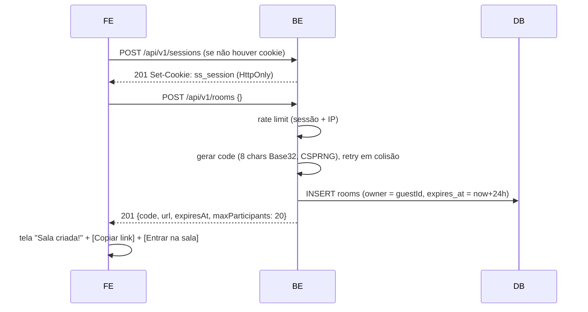
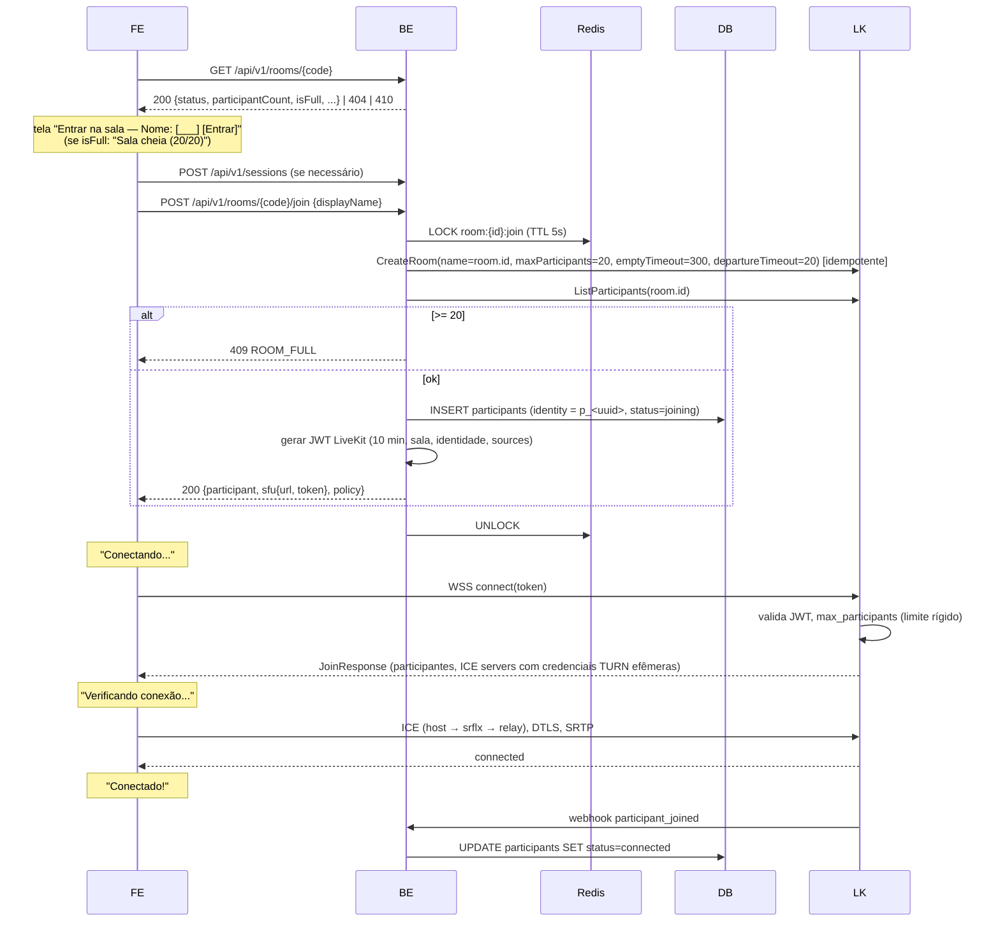
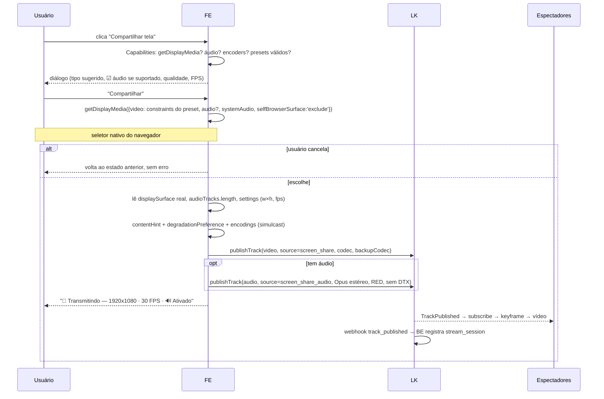
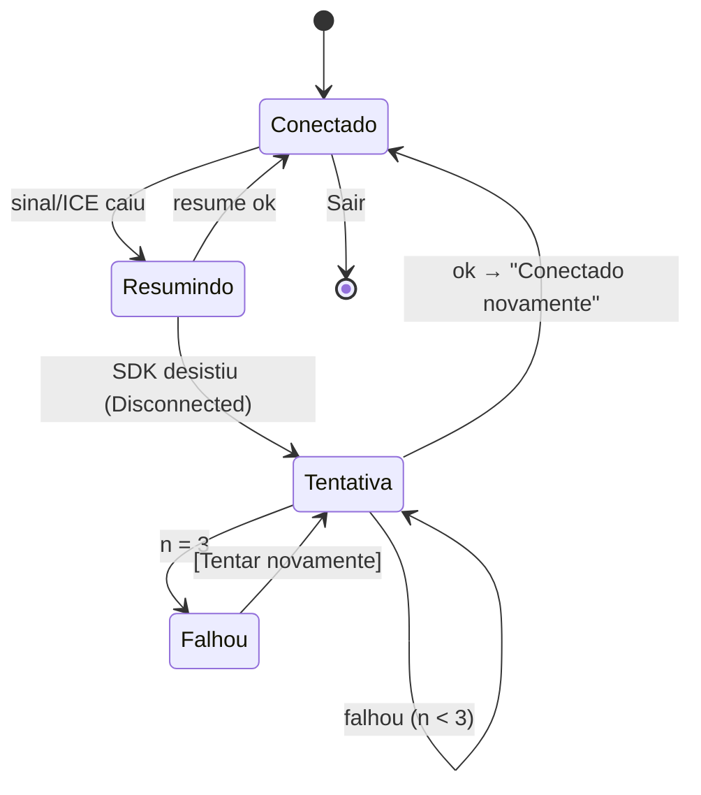

# Documento 2 — Fluxos

Legenda: **FE** = frontend (navegador), **BE** = backend .NET, **LK** = LiveKit (SFU), **TURN** = coturn, **DB** = Postgres, **R** = Redis.

## 0. Visão da sinalização

```text
                 (1) REST/HTTPS                     (3) Twirp HTTP + Webhooks
   Navegador  ─────────────────────►  Backend  ◄─────────────────────────────►  LiveKit
      │        sessão, sala, token                criar sala, listar, remover      ▲
      │                                           participant_joined/left, ...     │
      │                                                                             │
      └──────────────────── (2) WSS: sinalização WebRTC ────────────────────────────┤
      │          JoinRequest → JoinResponse(ICE servers, participantes)             │
      │          Offer/Answer SDP, ICE trickle, AddTrack, Subscribe, Mute,          │
      │          ConnectionQuality, Leave, TokenRefresh                             │
      │                                                                             │
      └──────────────────── (4) Mídia SRTP/UDP (ou ICE/TCP, ou via TURN) ───────────┘
```

O backend emite o token e sai do caminho. A partir daí, tudo o que é tempo real é entre navegador e SFU.

## 1. Criar sala



A sala no LiveKit **não** é criada aqui (evita salas vazias no SFU); é criada no primeiro join.

## 2. Entrar na sala



Pontos importantes:
- O lock Redis garante que 2 joins simultâneos não passem ambos quando há 19 pessoas. O `max_participants` do LiveKit é a rede de segurança (se falhar, FE mostra "Sala cheia").
- Contagem vem do LiveKit (fonte da verdade de quem está conectado), não do banco.
- O token não tem grant de admin; o FE não consegue criar salas nem remover pessoas no SFU.

## 3. Conectar WebRTC (dentro do passo anterior, em detalhe)

1. FE abre WSS com o LiveKit usando o token.
2. LiveKit responde `JoinResponse` com: lista de participantes e tracks, `iceServers` (STUN + TURN com usuário/senha efêmeros derivados de `TURN_SECRET`), configuração de codecs.
3. FE cria a(s) `RTCPeerConnection` (`iceTransportPolicy: 'all'`) — o SDK usa uma conexão para publicar e uma para assinar (ou uma única, conforme versão/protocolo).
4. Coleta de candidatos em paralelo; ICE escolhe o melhor par funcionando, nesta ordem de preferência natural:
   1. UDP direto ao IP público do SFU (caso normal, inclusive atrás de NAT/CGNAT — é o cliente quem inicia);
   2. TCP 7881 direto ao SFU (UDP bloqueado);
   3. TURN/UDP 3478 → TURN/TCP → TURN/TLS 5349/443 (firewall corporativo, proxy, só 443 liberado).
5. DTLS handshake → SRTP. Assinaturas automáticas das tracks existentes (ex.: se alguém já está compartilhando, o vídeo aparece em seguida, com keyframe pedido pelo SFU).

## 4. Iniciar transmissão



Se pediu áudio e não veio track: aviso informativo, transmissão continua só com vídeo.
Se o usuário parar pelo botão nativo do navegador ("Parar compartilhamento" da barra do Chrome), o evento `ended` da track dispara o fluxo 5.

## 5. Parar transmissão

1. Gatilho: botão "Parar compartilhamento", evento `ended` da track de vídeo (barra nativa do navegador), ou saída da sala.
2. FE: `unpublishTrack(video)` e `unpublishTrack(audio)` → `track.stop()` em ambas (libera a captura, some o indicador do SO).
3. LK: `TrackUnpublished` para todos → espectadores voltam ao estado "Ninguém está compartilhando" (ou ao próximo stream, se houver outro).
4. Webhook `track_unpublished` → BE fecha `stream_session` (`ended_at`).

## 6. Alterar qualidade / FPS

```mermaid
sequenceDiagram
    participant U as Usuário
    participant QC as QualityController
    participant T as MediaStreamTrack
    participant S as RTCRtpSender
    participant LK
    U->>QC: 720p · 60 FPS
    QC->>QC: valida contra capacidades (fonte, encoder, uplink, policy)
    QC->>T: applyConstraints({height:{max:720}, frameRate:{max:60}})
    QC->>T: contentHint = 'motion'
    QC->>S: setParameters(encodings[].maxBitrate/maxFramerate, degradationPreference='maintain-framerate')
    alt mudou codec
        QC->>LK: unpublish + publish da MESMA track (sem novo seletor)
    end
    QC-->>U: indicador atualizado; log quality_changed (telemetria)
```

- Nenhuma chamada ao backend é necessária; a política já veio no join.
- O controlador adaptativo usa esse preset como **teto**.

## 7. Reconexão

Três níveis, do mais barato ao mais caro:

| Nível | Quem faz | O que acontece | UI |
|---|---|---|---|
| 1. ICE restart / *resume* | SDK do LiveKit | Mesma sessão no SFU, mesmas tracks; em geral < 2 s (troca de Wi-Fi, perda breve) | "Reconectando..." discreto |
| 2. Reconexão completa do SDK | SDK do LiveKit | Novo PeerConnection, republica tracks locais automaticamente | "Reconectando..." |
| 3. Reconexão da aplicação | `ReconnectManager` | Novo token via `POST /join` com `participantId` (mesma identidade) e novo `connect`; até **3 tentativas** com backoff 1 s / 3 s / 7 s | "Reconectando... Tentativa 1/3" |



Detalhes:
- **A captura de tela não é interrompida** durante a reconexão: a `MediaStreamTrack` continua viva e é republicada ao reconectar — o usuário não vê o seletor de novo.
- Se `navigator.onLine === false`, a tentativa espera o evento `online` (não gasta tentativas à toa).
- Reusar a mesma `identity` faz o LiveKit derrubar a sessão-fantasma anterior, então o reconectado não ocupa duas vagas da sala.
- Espectadores, quando o transmissor tem problemas: o SFU mantém a publicação por `departureTimeout` (20 s); o último frame fica na tela com selo "Transmissão instável", nunca tela preta imediata.
- Participantes remotos: `ConnectionQuality.Lost` → "reconectando"; `ParticipantDisconnected` → "desconectado" por alguns segundos, depois some da lista.

## 8. Sair

1. FE: para capturas locais, `room.disconnect()` (envia `Leave` ao SFU — saída imediata, sem esperar timeout).
2. FE: `navigator.sendBeacon('/api/v1/rooms/{code}/leave', {participantId})` — melhor esforço (fechar aba).
3. LK → BE: webhook `participant_left` (fonte da verdade) → `participants.left_at`, `leave_reason`.
4. Última pessoa saiu: LiveKit fecha a sala após `emptyTimeout` (5 min) → webhook `room_finished`. A sala do app continua válida até `expires_at` (24 h desde a última atividade), podendo ser reaberta pelo mesmo link.

## 9. Expiração e limpeza

`BackgroundService` a cada 10 min: marca como `expired` salas com `last_activity_at + 24 h < now` e sem participantes; remove participantes-fantasma (`status=joining` há mais de 5 min sem webhook de entrada).
