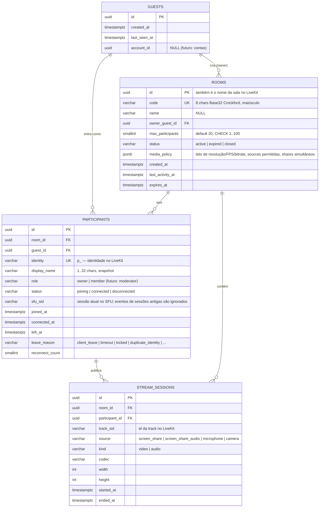

# Documento 3 — Banco de dados (PostgreSQL)

Princípio: o banco guarda **estado da aplicação e histórico**, não estado de tempo real. Quem está conectado *agora* é respondido pelo LiveKit; o banco é atualizado pelos webhooks.

## Diagrama

## Índices e restrições

| Tabela | Índice / restrição | Uso |
|---|---|---|
| rooms | `UNIQUE (code)` | Resolver `/room/{code}` |
| rooms | `(status, expires_at)` | Job de expiração |
| participants | `UNIQUE (identity)` | Correlacionar webhooks |
| participants | `(room_id) WHERE left_at IS NULL` (parcial) | Presentes na sala |
| stream_sessions | `(room_id, started_at DESC)` | Histórico |
| stream_sessions | `UNIQUE (track_sid)` | Idempotência de webhook |

## Decisões

- **`source` é campo próprio em `stream_sessions`** — áudio e vídeo nunca são a mesma linha. Voz (`microphone`) entra sem migração.
- **`media_policy` em JSONB**: evolui (codec permitido, áudio permitido, 4K permitido) sem migração a cada ajuste; validada por um tipo C# fortemente tipado.
- **`guests` separado de `participants`**: a mesma pessoa (cookie) pode entrar em várias salas e, no futuro, ser vinculada a uma conta (`account_id`).
- **Webhooks idempotentes**: LiveKit pode reenviar eventos; usamos `identity`/`track_sid` + `ON CONFLICT`.
- **Sem tabela de eventos/auditoria no MVP**: logs estruturados cobrem isso (Documento 5). Pode virar tabela quando "histórico" for requisito.
- **Chaves UUID v7** (ordenáveis por tempo) geradas na aplicação.

## Preparado para o futuro (não criar agora)

| Funcionalidade | Mudança prevista |
|---|---|
| Contas | tabela `accounts`; `guests.account_id` já existe |
| Senha / sala privada | `rooms.password_hash`, `rooms.visibility` |
| Moderador / expulsar / bloquear | `participants.role` já existe; tabela `room_bans (room_id, guest_id/account_id, reason, until)` |
| Chat | `chat_messages (room_id, participant_id, body, created_at)` — ou só via data channel sem persistir |
| Gravação | `recordings` + LiveKit Egress (fora do caminho de baixa latência) |
